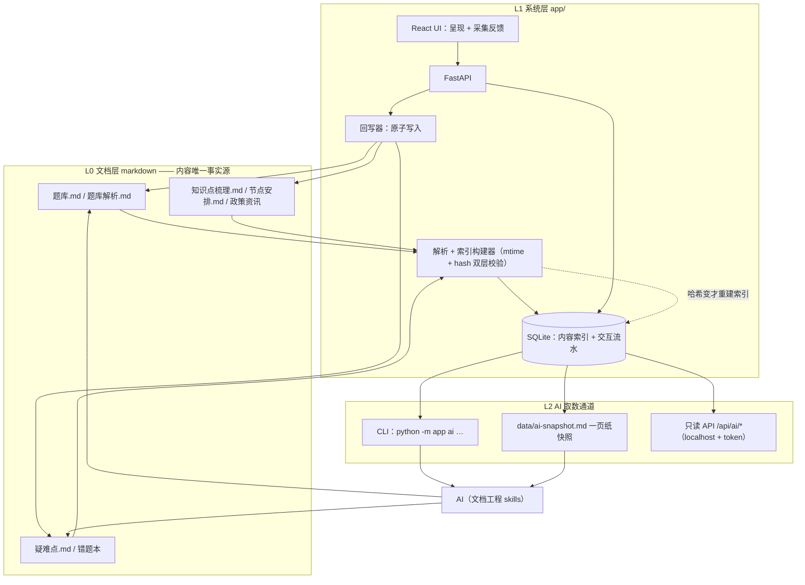
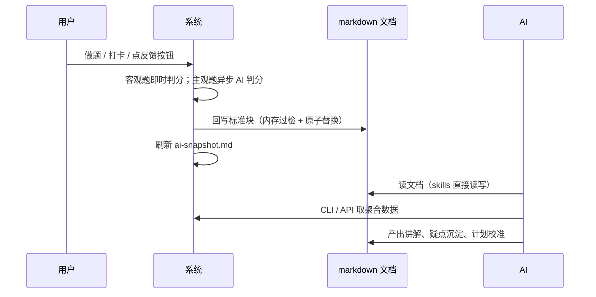

# 复习管理系统 · 总体设计

> 代号说明：P0–P8 为实施分期编号，本文含义唯一；R17/R18/R19 为 danzhao-docs 校验器规则号（题库文档禁内联答案 / 套题须有五类错因订正反馈块 / 评估与反馈一致性）；L0/L1/L2 为三层模型层号。

## 定位

本系统是复习文档工程的「手脚」：不替代 AI 的思考，负责把学习结果呈现得更好、把用户反馈收集起来喂给 AI、并给 AI 留出获取数据的途径。AI 的交互与决策留在文档工程（markdown + skills），系统围绕文档运转。

设计原则：

1. 文档（markdown）是内容唯一事实源；系统只读解析、按标准块回写，不擅自改内容。
2. 交互流水落 SQLite，汇总后按 danzhao-docs 契约回写文档，供 AI 消费。
3. AI 取数是一等公民：CLI、只读 API、一页纸快照三种通道常驻。

## 技术选型

| 层 | 选型 | 理由 |
| --- | --- | --- |
| 前端 | React 18 + Vite + TypeScript + antd + TanStack Query | 多模块 SPA；图表用 ECharts |
| 后端 | FastAPI + SQLAlchemy 2.x + Pydantic v2 | 自动 OpenAPI，契约即代码 |
| 数据库 | SQLite（WAL 模式） | 单机单人零运维；备份即拷贝文件 |
| 联调 | 开发期 Vite proxy `/api` → 8000；生产由 FastAPI 托管前端 dist | 不开 CORS，单命令起全栈 |

单机单人场景的显式简化：不做账号体系（表结构预留 `user_id` 备用）、不开 CORS、不上容器。React 的 Node 只是构建链，不常驻服务——编译产物由 Python 托管，省一套运行时运维。

Windows 落地要点：`start.py` 跨平台一键启动器（查找 Python → 建 venv → 装依赖 → 按需构建前端 → 起后端），普通用户双击 `启动服务.bat`（macOS/Linux 用 `启动服务.sh`），`start.ps1` 为兼容薄包装，用户引导见 `app/启动说明.md`；Python ≥ 3.11、Node LTS 20/22，版本由 `requirements.txt` 与 `package-lock.json` 锁定；所有文件读写显式 `utf-8`。

## 三层模型



反馈回路（系统如何「喂」AI）：



## 数据所有权划分

| 数据 | 事实源 | 系统职责 |
| --- | --- | --- |
| 题库、解析、知识点、政策、计划内容 | markdown | 只读解析 + 建索引；回写仅限标准块 |
| 答题流水 attempts | SQLite | 高频追加（一次提交 = 同 batch_id 多行；写 md 会爆炸）；汇总后按需导出回写 |
| 打卡记录 | SQLite | 明细入 DB；节点总表「状态」列按 ⬜→🟨→✅ 规则回写 |
| 疑难点频次 | `疑难点.md` | UI 反馈按钮按既有行格式累加，与 auto-discover 共用同一张表 |

SQLite 定位为「索引 + 流水账」，不是内容事实源；markdown 不退役，既是系统的上游也是下游。删掉 `app/data/quiz.db` 只需跑一次全量重建，系统原地复活，题目、解析与笔记本体不受任何影响。

## 关键技术契约

以下四约是「Markdown 事实源」落地为工程代码的地基，P1/P2 实现并配 pytest，先于 UI 与 CLI 完成。

### 题目标识（qid）

attempts 流水绑定 qid，**不绑章节名 + 物理序号**——在文档中间增删题目会导致后续题目的历史全部错位。

- 显式 ID 优先：题库既有题头格式已带 ID（`### 第 N 题（SX-001，选择题，……）`），直接沿用，与 `题库解析.md` 按 ID 对应的答案键映射天然对齐。
- 无显式 ID 时用内容指纹兜底：`MD5(所属学科 + 所属套题 + 题干纯文本前 30 字)[:12]`。
- 全局唯一化：显式 ID 在不同文件间可能重名，索引主键取 `(file_path, qid)`；attempts 侧同样存完整 `file_path + qid`。
- 已知代价：改题干前 30 字（如修 typo）会换指纹、孤立该题历史；显式 ID 题目不受影响，故以显式 ID 为主路径。

### 索引失效校验（mtime + hash 双层）

Windows 下 Git 切分支、IDE 后台格式化都会推 mtime，单纯 mtime 触发会频繁冗余全量解析。

- `mtime` 变化时先算文件 `sha256`，与 `doc_files.content_hash` 比对，**哈希不变则跳过解析**。
- 哈希变或新文件才执行正则切分与索引更新（按文件删旧插新，单事务）；`--rebuild` 提供全量重建兜底。

### 原子回写（写时复制三步法）

Windows 多进程（IDE 自动保存、AI 写入、系统回写）同写一文件，直接覆写会 `PermissionError` 或互相覆盖。回写固定三步：

1. **读前比对**：进入回写任务时记录目标文件哈希；执行前重读比对，不一致判定外部修改，放弃覆盖、转待同步队列并告警。
2. **临时文件 + 内存过检**：新内容写同目录 `.<原名>.tmp`；过检**不跑磁盘上的临时文件**——校验器 R17/R18/R19 按文件名命中，`题库.md.tmp` 这个名字会整体绕过规则。正确做法是 import `check_docs`，以目标文件的仓库相对路径作 `rel`，对内存中的新内容直接跑 `FILE_RULES`。
3. **原子替换**：ERROR 级问题为零才 `os.replace(临时文件, 目标文件)`，瞬时完成，不留半截文件。

另加文件锁兜底并发互斥。

### 判分解耦（主客观状态机）

客观题脚本判分 10ms 级，大模型判分 3–8s 且可能网络异常，两者不可绑在同一流程里阻塞交卷。

- 提交即状态机分流：客观题当场出分写库（`eval_state = done`）；主观题置 `evaluating`，由 FastAPI `BackgroundTasks` 异步判分。
- 前端先渲染客观题结果与得分，主观题位显示「评判中」，轮询到结果后原位更新。
- AI 超时或失败：降级为「待人工复核」（`is_correct = NULL`，`eval_state = pending_manual`），提供重试入口，不阻塞整卷。

## SQLite Schema 参考

四张表对应「只读索引 + 高频流水」职责分离；流水表预留可空 `user_id`，单用户暂不用。

```sql
-- 文档状态监控（防冗余重建）
CREATE TABLE doc_files (
    file_path TEXT PRIMARY KEY,
    content_hash TEXT NOT NULL,
    last_indexed_at DATETIME NOT NULL
);

-- 题目索引（纯只读缓存，来自 markdown 解析；answer_key 仅服务端可见，不下发前端）
CREATE TABLE questions_index (
    file_path TEXT NOT NULL,
    qid TEXT NOT NULL,              -- 显式 ID 优先，内容指纹兜底
    section_title TEXT NOT NULL,    -- 所属套题/章节
    q_type TEXT NOT NULL,
    stem TEXT NOT NULL,
    options_json TEXT,
    answer_key TEXT NOT NULL,
    difficulty TEXT,
    tags_json TEXT,
    PRIMARY KEY (file_path, qid)
);

-- 做题流水（一次提交 = 同 batch_id 的多行）
CREATE TABLE quiz_attempts (
    id INTEGER PRIMARY KEY AUTOINCREMENT,
    batch_id TEXT NOT NULL,
    file_path TEXT NOT NULL,
    qid TEXT NOT NULL,
    user_answer TEXT,
    is_correct BOOLEAN,             -- 1 对 / 0 错 / NULL 待判
    eval_type TEXT NOT NULL,        -- auto / ai / manual
    eval_state TEXT NOT NULL DEFAULT 'done',  -- done / evaluating / pending_manual
    cost_seconds INTEGER,
    error_type TEXT,                -- R18 五类错因
    user_id INTEGER,                -- 预留，单用户暂空
    created_at DATETIME DEFAULT CURRENT_TIMESTAMP
);
CREATE INDEX idx_attempts_qid ON quiz_attempts(qid, created_at);
CREATE INDEX idx_attempts_batch ON quiz_attempts(batch_id);

-- 节点打卡明细（定期汇总回写 节点安排.md 状态列）
CREATE TABLE plan_checkins (
    id INTEGER PRIMARY KEY AUTOINCREMENT,
    node_id TEXT NOT NULL,
    status TEXT NOT NULL,           -- ⬜ / 🟨 / ✅
    notes TEXT,
    user_id INTEGER,                -- 预留，单用户暂空
    created_at DATETIME DEFAULT CURRENT_TIMESTAMP
);
```

## 模块划分

后端按 `app/modules/<模块>/` 分包，每模块 `router + schemas + service`；前端按模块分页面。

| 模块 | 职责 |
| --- | --- |
| quiz | 题型管理、组卷、服务端判分（答案键不下发前端；主客观状态机分流） |
| wrongbook | 错题自动收录、错因标签、1/3/7/15 天到期回顾 |
| plan | 节点计划、打卡、节点总表状态回写 |
| stats | 掌握度 / 薄弱点 / 趋势聚合（供仪表盘与 AI 快照） |
| knowledge | 知识点库 + Anki 卡组索引 |
| policy | 考试大纲、报名时间、志愿信息 |
| ai-access | 跨模块取数：CLI、快照、只读 API |

## AI 取数通道

| 通道 | 形态 | 用途 |
| --- | --- | --- |
| CLI | `python -m app ai summary / weak / pending / recent / doubt / plan`，默认输出 markdown、`--json` 输出机器可读 | IDE 内直接查询，替代手刷多个 md |
| 一页纸快照 | `app/data/ai-snapshot.md`，每次交互后自动刷新 | AI 会话开始读一个文件拿全貌：总量、正确率、薄弱 Top、待复核、疑难点 Top、打卡进度 |
| 只读 API | `/api/ai/*` 同源聚合，localhost + token | 给将来的 AI 客户端预留 |

反向同步：系统监听 markdown 的 mtime，变更经哈希比对确认后重建索引——AI 改了文档，系统无感跟进，不需要 AI 通知系统。

## 回写契约

回写是系统与文档工程之间的唯一写接口，破坏契约即污染 AI 的输入，故为硬约束：

- **题库.md**：判分结果写入套题章节下的三块——作答记录、订正反馈（R18 要求的五类错因行：概念不清/计算失误/思路错误/审题偏差/知识遗忘）、评估（总体掌握与反馈「是否攻克」保持一致，即 R19）。答案与解析不内联（R17）。`web/lib.py` 的 `write_back` 已是合规样板，移植时保持其块级替换结构。
- **疑难点.md**：严格按既有 8 列行格式（专题/学科/出现次数/首次出现/最近出现/关联问题摘要/对应章节链接/状态）累加。
- **节点安排.md**：只改「节点总表」的状态列，其余列冻结。
- **写入前过检**：过检在内存中的新内容上运行校验器规则函数（import `check_docs` 跑 `FILE_RULES`），ERROR 级不过即拒绝写入；规则随仓库演进，系统不复制规则。机制见「关键技术契约 · 原子回写」。
- **写入互斥**：AI 与系统可能同写一文件——按块级分离（AI 写内容块、系统写反馈块）+ 哈希比对 + 文件锁，机制见「关键技术契约 · 原子回写」。

## 分期计划

| 期 | 内容 | 验收 |
| --- | --- | --- |
| P0 | 骨架：目录结构、`start.ps1`、FastAPI/Vite 联通、SQLite WAL 建库 | Windows 一键起全栈，health 通 |
| P1 ✅ | 文档解析层 + 索引构建器（移植 `web/lib.py`：qid 契约、mtime+hash 双层校验、全量重建） | 已实现：parser + indexer，单元测试 8 项通过；真实语料 24 文档受监控 / 20 题入索引（标准 `### 第N题` 格式；其余表格草稿形态待补标准格式） |
| P2 | 测验引擎：服务端判分 + AI 判简答 + R18 回写 + 原子写入 | 替代 `web/` 主功能；判分与回写冲突有 pytest 覆盖 |
| P3 | 错题本联动 + UI 反馈按钮（错因自选、「解析没看懂」→ 疑难点.md 累加） | 做题错题自动入库，反馈直达 AI 的表 |
| P4 | 复习计划打卡 + 节点状态回写 | 打卡明细入 DB，节点表状态列按规则变 |
| P5 | 学情仪表盘（ECharts 趋势 + 薄弱点） | 与 stats 模块数据一致 |
| P6 | 资料库 + 政策资讯 | 纯 CRUD 走索引层 |
| P7 | AI 取数通道：CLI + 快照 + `/api/ai/*` | `python -m app ai summary` 可跑 |
| P8 | `web/` 退役；README 与指导手册同步新结构 | `check_docs.py` 全仓通过 |

## 风险与对策

| 风险 | 对策 |
| --- | --- |
| 回写竞态 / 半截文件（Windows 多进程同写） | 原子回写三步法（哈希比对 + 内存过检 + `os.replace`）；P2 重点测试 |
| 索引与 markdown 不一致 | mtime + sha256 双层校验 + 全量重建兜底 |
| 题目增删导致历史错位 | qid 契约（显式 ID 优先 + 内容指纹兜底）；P1 pytest |
| 校验器规则演进破坏回写 | 调用仓库 `check_docs.py` 本体跑 `FILE_RULES`，不复制规则 |
| 判分逻辑迁移出错 | 判分是唯一「错一步全盘错」的模块，移植必须带 pytest 覆盖 |
| AI 判题失败 | 主客观状态机分流，失败降级为「待人工复核」并可重试 |
| SQLite 数据丢失 | 关机时拷贝 `app/data/quiz.db`，或后端提供 backup 导出端点 |

## 与既有 web/ 的关系

新系统（P2 起）覆盖 `web/` 全部能力后 `web/` 退役；判分与回写逻辑从 `web/lib.py` 移植，测试覆盖后删除旧服务。
